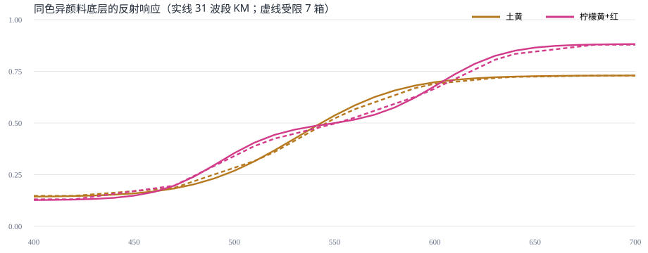

# 色料模型实验：光谱 KM 与受限参数色料表示

> 本文件的数值由 `npm run experiments` 调用 `tools/run-pigment-model-experiments.mjs` 现场复算。
> 完整机器可读数据：`tools/out/pigment-model-experiments.json`；反射率 CSV：
> `tools/out/pigment-reflection-responses.csv`；反射曲线：
> `tools/out/pigment-reflection-responses.svg`。不要手工把某次屏幕取色当成物理混色结论。

## 1. 本轮结论

1. **物质账本应统一在色料质量域。** 画笔、湿膜、干层、封存隔离和清水回取都只转移/冻结每种色料的质量；光学层是由 `m、h、wet、base` 推导出的映射。这样反复混合和水洗后的“剩余颜料量＋离开画布的颜料量”能对账，本轮反复分盘混合的最大相对质量漂移为 **1.60e-15**。
2. **光学层与物质层不做双向自由编辑。** 若允许直接改 K/S 或 RGB 又反向猜质量，映射会漂移；当前实现保留 `pixelFilmList()` 这一单向映射，并在保存状态中持久化每层质量数组，而不是保存截图颜色。
3. **31 波段光谱 KM 与受限 7 箱参数模型接入完全相同的覆盖厚度 `h=4` 和浓度 `c=0.55`。** 受限模型把每色料 62 个 K/S 数压缩为 14 个非负箱参数；参数总量从 620 降到 140。本轮 Node 微基准（120 次）为光谱 3.81 μs/次、受限 9.17 μs/次；说明在这个小原型里，参数/内存减少并不自动等于端到端更快，箱平均与反射率插值也有固定成本。
4. **同色异颜料只能在指定光源下成立。** 两片试混片在明亮 D65 下 ΔE00=**0.291**（接近同色），在暖 A 光源适应色度下分离到 ΔE00=**3.390**；压暗到 45% 曝光后导出像素的 ΔE00=**2.833**。只调屏幕 Hex、不保存光谱和质量的实现无法复算这一差别。
5. **封存是物质可达性政策，不是把颜色锁住。** 未封存的可溶土黄底层遇同一滴清水会失去 1.584 原型质量单位；先封存后滴水失去 **0**。耐水的柠檬黄＋红底层在两种路径下都不被水带走。被带走的质量进入水滴/流出物，因此总色料量仍为 2.2000。
6. **RGB 平均只能当反例控件。** 下表 `rgbAverageControl` 与 KM 预混的 ΔE00 在互补色/深色区域可超过 7，且它没有厚度、底色、透明度和质量账本；画布渲染不使用该路径。

## 2. 两种模型与同一厚度输入

- `spectral-km`：`js/km.js` 的 31 波段二通量 Kubelka–Munk；色料 K/S 来自 `js/pigments.js` 的人工高斯/吸收边参数。
- `constrained-ks`：`js/pigment-lab.js` 的 7 个连续波段箱，K/S 被约束为非负箱均值，只在 7 个箱上执行 KM，再在线性反射率域插值回 31 波段。它不是 RGB 三通道平均。
- 两个入口都是 `mixWithModel(modelId, masses, h, baseSpectrum, wet)`；实验固定 `h=4`、`M=c h=2.2`。

## 3. 同色异颜料试混片

| 试混片 | ID | 配方（质量份数） | 结合剂 | 明 D65 Hex | 暗暖光 Hex | 模型 ΔE 明 | 模型 ΔE 暖 | 光谱 RMSE |
| --- | --- | --- | --- | --- | --- | --- | --- | --- |
| 土黄单颜料底层 | `ochre-ground` | py43-ochre:1 | 可溶 | #eab963 | #a78442 | 1.23 | 1.46 | 0.0109 |
| 柠檬黄＋吡咯红异颜料底层 | `lemon-red-ground` | py-lemon:0.927, pr-red:0.073 | 耐水 | #e9b965 | #ab8146 | 1.13 | 0.70 | 0.0143 |

模型间颜色差不是“哪一个 RGB 更好看”的判断，而是同一质量输入经两种光学表示后的响应差。完整 31 点反射率见 CSV/JSON。

## 4. 封存前/后滴同一滴清水

水滴参数固定为 `volume=0.85`、`lift=0.72`。“剩余”只计试片，“总量”计试片＋水滴/流出物。

| 底层 | 可溶性 | 封存前带走 | 封存前明色 | 封存前剩余 | 封存路径总量 | 封存后带走 | 封存后明色 | 封存后剩余 |
| --- | --- | --- | --- | --- | --- | --- | --- | --- |
| 土黄单颜料底层 | 可溶 | 1.5840 | #ffca47 | 0.6160 | 2.200000 | 0.0000 | #eab963 | 2.2000 |
| 柠檬黄＋吡咯红异颜料底层 | 耐水 | 0.0000 | #e5aa50 | 2.2000 | 2.200000 | 0.0000 | #e9b965 | 2.2000 |

UI 路径：右栏 **封存试混** → **滴同一滴清水**；重置后 **封存全部湿样** → **滴同一滴清水**。导出 JSON 同时含活动样状态和确定性实验报告。

## 5. 反复混合的质量守恒

| 模型/政策 | 周期 | 初始记账质量 | 最终质量 | 最大绝对漂移 | 最大相对漂移 |
| --- | --- | --- | --- | --- | --- |
| spectral-km / 质量域 | 64 | 42.240000000 | 42.240000000 | 6.750e-14 | 1.598e-15 |
| constrained-ks / 同一质量域 | 64 | 42.240000000 | 42.240000000 | 6.750e-14 | 1.598e-15 |

两种光学模型的守恒相同，是因为守恒发生在它们之前的物质质量域；如果让受限光学参数反向充当物质状态，就必须额外维护双向映射和漂移检查。

## 6. 互补颜色、薄层与 RGB 平均误差

`Δ顺序` 是 AB/BA 薄层顺序差，`Δ层/混` 是叠涂与均质预混差，`ΔKM/RGB平均` 只用于标记朴素 RGB 平均反例离物理光谱结论多远。

| 互补对 | h | AB | BA | KM预混 | RGB平均反例 | Δ顺序 | Δ层/混 | ΔKM/RGB | 受限ΔE |
| --- | --- | --- | --- | --- | --- | --- | --- | --- | --- |
| 黄×青蓝（互补附近） | 0.08 | #c0f5c9 | #c3f6c7 | #c1f5c8 | #dcf8de | 0.88 | 0.43 | 7.17 | 2.10 |
| 黄×青蓝（互补附近） | 0.32 | #3be0a3 | #94e481 | #64e28d | #7fedb8 | 12.06 | 6.06 | 7.20 | 3.02 |
| 黄×青蓝（互补附近） | 1.28 | #00bdc8 | #d4d765 | #5ec982 | #80d8a9 | 39.56 | 25.64 | 7.09 | 3.50 |
| 黄×青蓝（互补附近） | 2.56 | #00b8db | #eadb62 | #62c683 | #80d0a8 | 48.34 | 33.97 | 7.36 | 3.31 |
| 红×绿（强互补） | 0.08 | #cfbc9b | #d0ba98 | #d0bb99 | #e3dbc2 | 1.79 | 1.09 | 9.12 | 0.97 |
| 红×绿（强互补） | 0.32 | #7a8b64 | #965e4c | #886f55 | #9da773 | 32.11 | 21.25 | 24.22 | 0.75 |
| 红×绿（强互补） | 1.28 | #3daf68 | #9d4a48 | #766654 | #5d8d57 | 60.83 | 33.98 | 25.31 | 0.61 |
| 红×绿（强互补） | 2.56 | #23bb67 | #a34948 | #766654 | #588757 | 66.26 | 36.99 | 24.55 | 0.61 |
| 品红×绿（互补） | 0.08 | #cfd1d9 | #d0d0da | #cfd0d9 | #e4e5e7 | 2.06 | 1.09 | 5.70 | 0.99 |
| 品红×绿（互补） | 0.32 | #75a89d | #9790b3 | #8399a6 | #aac0c8 | 27.51 | 14.72 | 11.40 | 5.78 |
| 品红×绿（互补） | 1.28 | #32b26b | #b86ac6 | #6f828b | #799caf | 49.14 | 29.78 | 9.73 | 6.25 |
| 品红×绿（互补） | 2.56 | #1fbb67 | #cb65d9 | #70818a | #7592ad | 52.62 | 32.60 | 9.09 | 5.49 |
| 土黄×群青（暖灰） | 0.08 | #c2ddda | #c4ded9 | #c2ddda | #deece7 | 0.73 | 0.33 | 5.78 | 2.78 |
| 土黄×群青（暖灰） | 0.32 | #5da1ae | #91b09b | #71a7a3 | #a6cac5 | 15.91 | 7.03 | 11.34 | 4.61 |
| 土黄×群青（暖灰） | 1.28 | #3f76ba | #c5ae68 | #698a88 | #9da0a1 | 49.56 | 22.93 | 14.95 | 3.92 |
| 土黄×群青（暖灰） | 2.56 | #4174c8 | #dab565 | #698988 | #9c979d | 54.57 | 24.85 | 19.16 | 3.82 |

可复算观察：极薄层的 AB/BA 顺序差较小；当厚度增加，分层顺序、吸收路径和深色混合会显著偏离“两份颜色平均”。互补色在厚混合时趋向低明度/低反射，RGB 平均通常给出过亮、过饱和的中间色。受限 7 箱模型降低参数量，但在这些陡吸收边附近会产生 8.05 ΔE00 量级的最大偏差，因此是否可接受取决于交互预览还是证据导出。

## 7. 深色混合

| 配方 | h | 明色 Hex | L* | 光谱↔受限 ΔE | RMSE |
| --- | --- | --- | --- | --- | --- |
| `black-only` | 0.4 | #36332f | 21.5 | 0.04 | 0.0003 |
| `black-only` | 2.5 | #1e1d1d | 11.0 | 0.00 | 0.0000 |
| `black-only` | 6.0 | #1e1d1d | 11.0 | 0.00 | 0.0000 |
| `black-umber` | 0.4 | #50483c | 31.1 | 0.56 | 0.0007 |
| `black-umber` | 2.5 | #2c2a27 | 17.1 | 0.20 | 0.0001 |
| `black-umber` | 6.0 | #2c2a27 | 17.1 | 0.20 | 0.0001 |
| `complement-dark` | 0.4 | #a28461 | 57.0 | 0.82 | 0.0335 |
| `complement-dark` | 2.5 | #766654 | 44.2 | 0.61 | 0.0147 |
| `complement-dark` | 6.0 | #766654 | 44.2 | 0.61 | 0.0146 |
| `blue-umber-dark` | 0.4 | #77c2a8 | 73.0 | 2.75 | 0.0200 |
| `blue-umber-dark` | 2.5 | #578776 | 52.4 | 2.63 | 0.0088 |
| `blue-umber-dark` | 6.0 | #588676 | 52.3 | 2.58 | 0.0086 |

深色路径的主要误差风险是反射率接近仪器/数值下限时，小的绝对光谱误差可能被色差或裁剪放大。当前 KM 使用稳定的 `tanh` 形式并把反射率限制在合法范围；界面用品红错误块显式暴露渲染异常，而不是静默返回一个平均色。

## 8. 成本与显示变换边界

| 项目 | 数值 |
| --- | --- |
| 光谱参数总数 | 620 |
| 受限参数总数 | 140 |
| 参数压缩比 | 4.43× |
| 光谱模型耗时 | 3.81 μs/call（120 次） |
| 受限模型耗时 | 9.17 μs/call（120 次） |

光谱积分、光源 SPD、Bradford 适应、XYZ→Lab/sRGB 是独立显示变换；混色内核只输出反射光谱和质量。增加 D65/A/昏暗暖光不会改变物质混合，只改变同一反射响应对观察者/显示输出的映射。

## 9. 执行证据与图形接点

- `npm test`：内核检查、新实验不变量、渲染缓冲逐像素等于显示变换。
- `npm run experiments`：生成本文所有数字及 JSON/CSV/SVG。
- `npm run preview`：生成厚度梯度、比例条和湿画/罩染 PNG。
- `node tools/browser-smoke.mjs`（或 `npm run smoke`）：真实浏览器启动、绘画、晾干、取样、测试台、封存试混、存取和导出冒烟。
- 浏览器执行证据：[`tools/out/integration-evidence.json`](../tools/out/integration-evidence.json)（2026-11-25T16:32:38.433Z）记录真实像素最大通道差 **0**、叠画 ΔE00=**51.498**、湿干 ΔE00=**3.686**、异常数 **0**；截图：`tools/out/ui-07-integration.png`。
- 图形主入口：`npm start` 后打开 `http://localhost:8123`。顶栏 **绘画接点自检** 会混合黄＋青、晾干、品红叠画，并读取真实 `#view` 像素与 `evaluatePixelColor()` 对照；右栏 **封存试混**（试混台）提供封存/水洗/导出及封存前后确定性对照。
- 命令行只负责测试、预览和实验复算，不替代绘画窗口。

## 10. 单列待验假设

混色表示取舍中尚未被真实颜料数据验证的假设，统一登记在
[`docs/混色表示取舍-待验假设.md`](./混色表示取舍-待验假设.md)。这些条目不得在 UI 或结论中表述为已实测事实。
